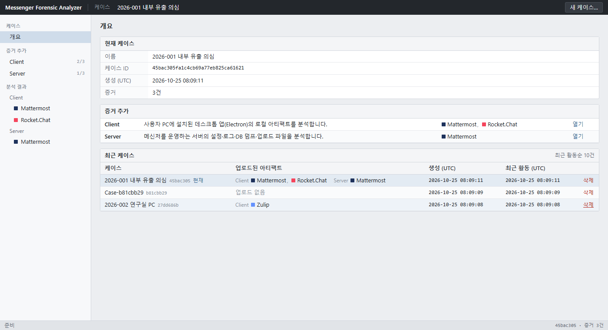
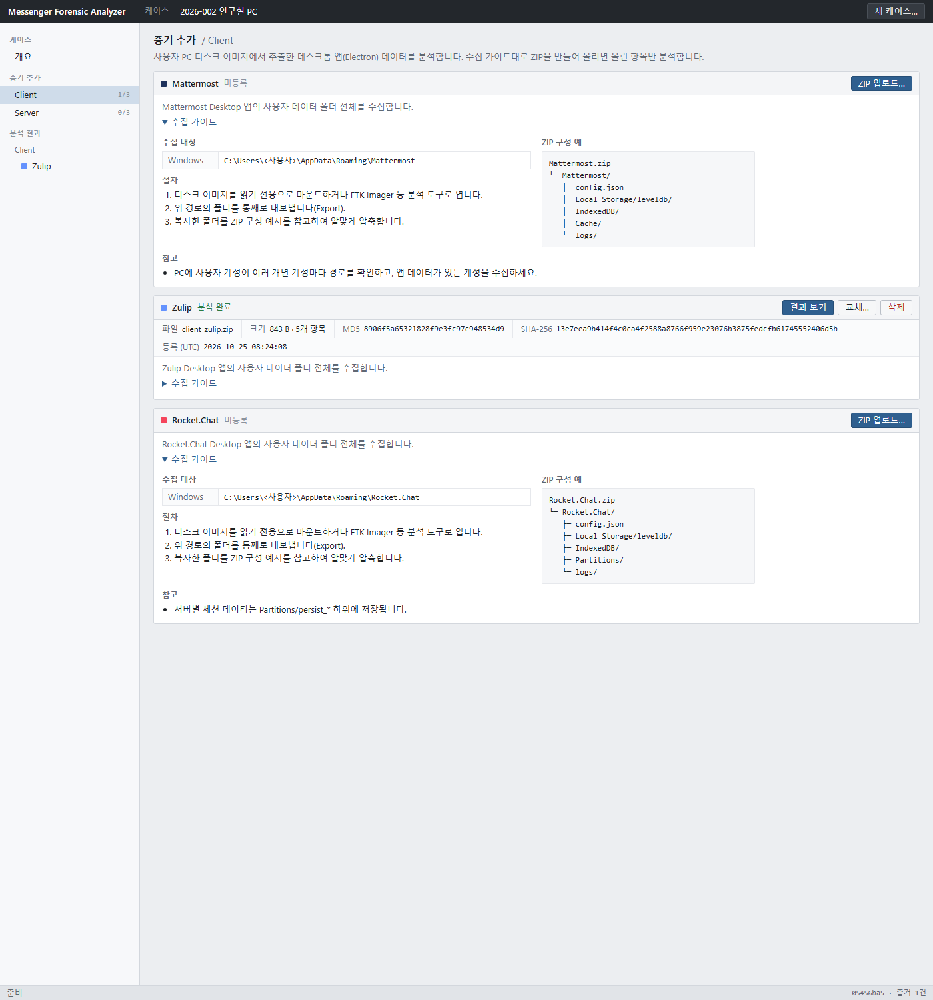
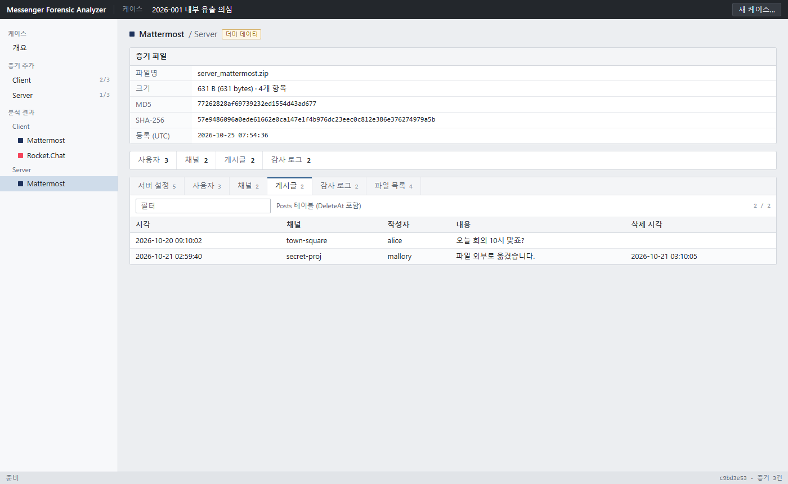

# selfhosted-chat-forensics

Mattermost, Zulip, Rocket.Chat 의 **Client**(데스크톱 앱)와 **Server** 아티팩트를 분석하는 웹 기반 디지털 포렌식 도구입니다.

*Web-based forensic artifact analyzer for self-hosted team chat: Mattermost, Zulip and Rocket.Chat (client & server, dead-box).*



## 무엇을 하나요

전원이 꺼진 PC, 서버의 디스크 이미지에서 추출한 파일을 ZIP 으로 올리면, 앱별 파서가 해석해 결과를 보여 줍니다.

1. 모드 선택 (Client / Server)
2. 앱별 수집 가이드 확인
3. ZIP 업로드 (앱 3개 × 모드 2개, 필요한 것만)
4. 올린 항목만 분석 → 결과 화면

수집 대상 (자세한 내용은 화면의 수집 가이드 참고):

| | Client (데스크톱 앱) | Server |
|---|---|---|
| **Mattermost** | `AppData\Roaming\Mattermost` | `/opt/mattermost/{config,data,logs}`, `/var/lib/postgresql` |
| **Zulip** | `AppData\Roaming\Zulip` | `/etc/zulip`, `/var/log/zulip`, `/home/zulip/uploads`, `/var/lib/postgresql` |
| **Rocket.Chat** | `AppData\Roaming\Rocket.Chat` | MongoDB 볼륨(`_data`), `/var/lib/docker/containers`, compose 폴더 |

Client 는 앱 데이터 폴더의 LevelDB, Local Storage, IndexedDB, Chromium 캐시를 Server 는 PostgreSQL(Mattermost, Zulip) 또는 MongoDB(Rocket.Chat) 데이터 디렉터리와 설정, 로그를 해석합니다.

### 주요 기능

- **오프라인 분석 전제**: 덤프(pg_dump, mongodump)가 아니라 **원본 데이터 디렉터리**를 직접 해석합니다. DB 서버를 띄울 필요가 없습니다.
- **삭제, 변조 흔적**: 삭제된 행, 이전 버전, WAL, oplog 에 남은 기록을 찾아 '확실 / 추정' 으로 구분해 보여 줍니다.
- **서버-클라이언트 교차 분석**: 같은 케이스에 같은 앱의 Client 와 Server 결과가 있으면 서로 대조합니다.
- **DB 원본 뷰어**: PostgreSQL, MongoDB 의 테이블, 컬렉션을 행 상태(live / deleted / updated)와 함께 봅니다.
- **원본 검색**: DB 전체, Chromium 캐시 본문, 추출 파일 바이트에서 검색합니다.
- **증거 무결성**: 업로드한 ZIP 의 MD5, SHA-256 을 기록하고, 재분석할 때 대조합니다.
- 시각은 모두 UTC 로 저장, 표기합니다.

| 증거 업로드 | 분석 결과 |
|---|---|
|  |  |

## 실행

Python 3.12 가 필요합니다.

```
pip install -r requirements.txt
```

```
run.bat                 # cmd
.\run.ps1               # PowerShell (다른 포트: .\run.ps1 -Port 8080)
```

브라우저에서 http://127.0.0.1:8000 을 엽니다. PowerShell 실행 정책 때문에 막히면
`powershell -ExecutionPolicy Bypass -File .\run.ps1` 로 실행합니다.

업로드한 증거와 분석 결과는 `workspace/` 에 저장됩니다 (`MFA_WORKSPACE` 환경변수로 위치 변경 가능).
이 폴더는 저장소에 올라가지 않습니다.

## 샘플 데이터

`samples/` 의 ZIP 을 업로드 화면에 끌어다 놓으면 바로 분석해 볼 수 있습니다.

| 파일 | 내용 |
|---|---|
| `samples/Client/Mattermost.zip`, `Zulip.zip`, `Rocket.Chat.zip` | 데스크톱 앱 데이터 폴더 |
| `samples/Server/Mattermost_server.zip`, `zulip_server.zip`, `rocketchat_server.zip` | 서버 설정 + DB 데이터 디렉터리 |

> 샘플은 외부와 분리된 **실험용 가상 환경**(사설 IP, 시험 계정)에서 만든 것입니다.
> 안에 들어 있는 계정, 비밀번호, 토큰, 키는 그 실험 환경에서만 쓰던 것으로, 실제 서비스와 무관합니다.

가짜 데이터로 화면만 확인하려면:

```
python scripts/make_samples.py   # samples/{client,server}_{app}.zip 생성
python scripts/seed_demo.py      # 데모 케이스 4개 생성 (서버 실행 불필요)
```

## 구조

```
backend/
|-- main.py          # API 라우트 + 정적 파일 서빙
|-- apps_meta.py     # 모드/앱 메타데이터 + 수집 가이드
|-- storage.py       # 케이스 폴더, 해시, 안전 압축해제, 결과 저장
|-- search.py        # 원본 검색 (DB, Chromium 캐시, 파일 바이트)
|-- crossref.py      # 서버-클라이언트 교차 분석
|-- pgaccess.py      # PGDATA → PostgreSQL 엔진
|-- mongoaccess.py   # MongoDB dbPath → MongoDB 엔진
|-- handles.py       # 열어 둔 원본(DB, 캐시) 수명 관리
|-- artifacts/       # Chromium 캐시, Rocket.Chat E2E
|-- parsers/         # client/, server/ 아래 앱별 파서
`-- vendor/          # 가져온 외부 코드 (VENDORED.md 참고)
frontend/            # index.html, css/, js/ (빌드, CDN 없는 Vanilla JS)
scripts/             # 가짜 샘플, 데모 케이스 생성
docs/                # 아티팩트 조사 문서, 화면 예시
samples/             # 샘플 증거 ZIP
```

기술 스택: Python 3.12, FastAPI, Uvicorn / Vanilla HTML, CSS, JS. 오프라인 환경에서도 동작하도록 프론트엔드는 외부 자원을 불러오지 않습니다.

## 참고 문서

`docs/` 의 `* Artifact.zip` 은 각 앱의 아티팩트 위치, 구조를 조사한 문서로, 파서 구현의 근거입니다.

## 가져온 외부 코드

`backend/vendor/` 의 코드는 동작을 바꾸지 않고 사용합니다. 출처와 파일 해시는 [`backend/vendor/VENDORED.md`](backend/vendor/VENDORED.md) 에 있습니다.

- **ccl_chromium_reader**: LevelDB, Local Storage, IndexedDB, Chromium 캐시 (MIT, Copyright 2020 CCL Forensics). 출처: [ws1004/ccl_chromium_reader_edit](https://github.com/ws1004/ccl_chromium_reader_edit) (CCL Forensics 원본 0.3.14 의 오류 수정판)
- **postgresql_viewer**: PostgreSQL 데이터 디렉터리 해석 엔진 (MIT). 출처: [ws1004/postgresql-viewer](https://github.com/ws1004/postgresql-viewer)
- **mongodb_viewer**: MongoDB(WiredTiger) dbPath 해석 엔진 (MIT). 출처: [ws1004/mongodb-viewer](https://github.com/ws1004/mongodb-viewer)

## 라이선스

[MIT](LICENSE). `backend/vendor/` 의 외부 코드는 각 폴더의 라이선스를 따릅니다.

## 알려진 제한

- PostgreSQL WAL 해석은 PostgreSQL 17 만 지원합니다 (힙 데이터는 18 도 해석).
- MongoDB 는 zstd, lz4 블록 압축과 저널 재생을 지원하지 않습니다.
- 서버는 127.0.0.1 에서만 동작하는 로컬 도구입니다. 외부에 공개해서 쓰지 마세요.
